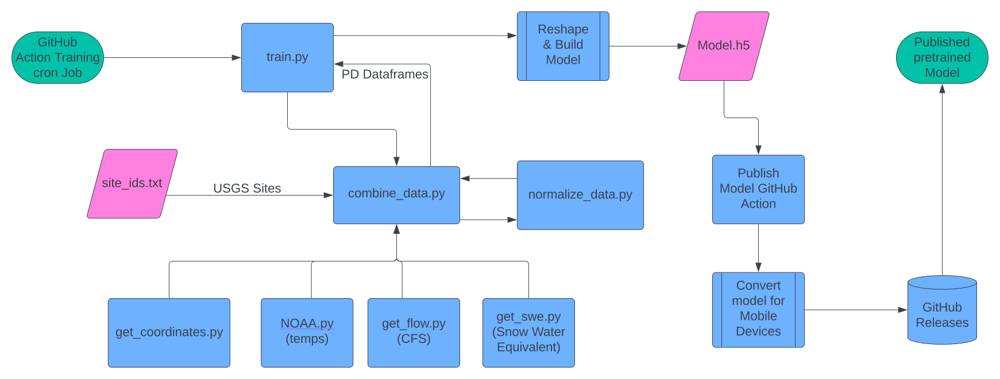

# OpenFlow
New here? See our wiki 
[wiki](https://github.com/tmart234/OpenFlow/wiki) to learn more

- [x] Automated dataset creation based on a USGS and CODWR station
- [x] GitHub actions ML training
- [x] Mobile artifacts published per training run (CoreML + TFLite + manifest) — see [docs/INFERENCE.md](docs/INFERENCE.md)
- [x] Upstream-gauge inputs: the model sees flood waves still upstream (e.g. Colorado's San Luis Valley -> Lower Taos Box) — see `openFlowML/data/upstream_gauges.json`
- [x] Basin rain by travel-time zone: gridMET / NWS Stage IV / NWS forecast rain and snow averaged over the river-distance zones of each gauge's contributing area (not a single point, not a fixed HUC level) — see `openFlowML/data/README.md`
- [x] Model releases: every passing training run on `dev`/`main` is published as a `model-YYYY.MM.DD` GitHub Release by the **Release Model** workflow (checksums + quality gate verified, quality report in the notes); any other run can be promoted by run ID
- [x] Forecast verification on every training run: per-station, per-lead-day error in cfs against a "no change" forecast, flood-peak and timing checks, and a quality gate that blocks publishing a worse model — see `openFlowML/evaluate.py` and `quality_report.md` in each release
- [x] Routing crest-timing backtest on every routed river's floods since 2015 (`openFlowML/crest_backtest.py`, CI workflow **Routing Crest Backtest**), and a daily forecast archive that scores OpenFlow routing, the NWS official forecast and the ML model against what the rivers did (`openFlowML/score_archive.py`) — see [docs/VERIFICATION.md](docs/VERIFICATION.md)
- [x] Forecast CLI with charts (no trained model needed): `python openFlowML/flow_forecast.py --site taos-box` (also `royal-gorge`, `conejos`, `dolores`; add `--model-dir <release>` to overlay the trained ML model) writes a CSV, JSON and PNG with the peak called out — upstream routing where upstream gauges are registered, else the official NWS forecast for the gauge; also runnable from the **Flow Forecast** GitHub Action
